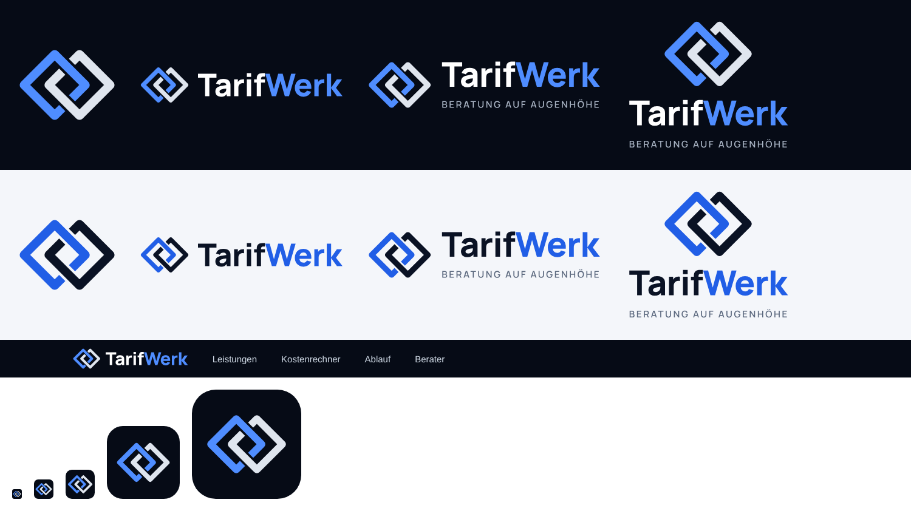
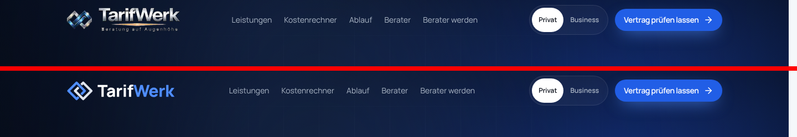
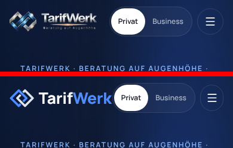

# TarifWerk – Logo und Icons

Flache Neufassung des TarifWerk-Logos. Die Idee bleibt erhalten: **zwei verschränkte Glieder**. Neu ist die Umsetzung: flach statt Chrom-Optik, beide Glieder gleich groß und auf gleicher Höhe – das passt zu „Beratung auf Augenhöhe“. Alles liegt als Vektor (SVG) vor, die Schrift ist in Pfade umgewandelt. Man braucht also keine Schriftart, um die Dateien anzuzeigen.



## Vorher / nachher im Header




## Welche Datei wofür?

| Datei (`svg/`) | Einsatz |
| --- | --- |
| `tarifwerk-logo-horizontal-dark.svg` | **Header** auf dunklem Grund (Standard auf der Webseite) |
| `tarifwerk-logo-horizontal-light.svg` | Header auf hellem Grund |
| `tarifwerk-logo-dark.svg` / `-light.svg` | Footer, E-Mail-Signatur, Briefkopf (mit Unterzeile) |
| `tarifwerk-logo-gestapelt-dark.svg` / `-light.svg` | Social-Media-Profil, Präsentationen, Flyer |
| `tarifwerk-zeichen-dark.svg` / `-light.svg` | Nur das Zeichen, z. B. Lade-Animation, Wasserzeichen |
| `tarifwerk-wortmarke-*.svg` | Nur der Schriftzug, falls Zeichen und Text getrennt gesetzt werden |
| `tarifwerk-icon.svg` | App-Icon (abgerundet) |
| `tarifwerk-icon-quadrat.svg` | Apple Touch Icon / maskable Icon (Apple rundet selbst) |
| `favicon.svg` | Browser-Tab |

Fertige PNGs liegen in `png/`. Austauschdateien mit **genau den Pfaden der Live-Seite** liegen in [`../public/`](../public).

## Regeln

- **Unterzeile nie im Header.** „Beratung auf Augenhöhe“ ist unter etwa 160 px Logobreite nicht mehr lesbar. Im Header kommt die Variante `horizontal` ohne Unterzeile, die Unterzeile nur im Footer, auf Social Media und in Dokumenten.
- **Mindestgröße:** Header-Logo mindestens 24 px hoch, Zeichen allein mindestens 16 px.
- **Schutzraum:** rundherum mindestens die Höhe des „T“ freilassen.
- **Nicht** verzerren, keine Schatten, keine Verläufe, keine Chrom-Effekte, nicht neu einfärben.
- **Dunkel/hell:** `-dark` auf dunklem Grund (#060b16), `-light` auf hellem Grund (weiß bis #f4f6fa).

## Farben (aus dem CSS der Webseite übernommen)

| Name | Hex | Verwendung |
| --- | --- | --- |
| Ink | `#060b16` | Hintergrund dunkel |
| Ink 900 | `#0a1224` | Schrift/Glied auf hellem Grund |
| Electric | `#4f8dff` | Glied + „Werk“ auf dunklem Grund |
| Electric Deep | `#215ee6` | Glied + „Werk“ auf hellem Grund |
| Silber hell | `#dfe5ee` | Zweites Glied auf dunklem Grund |
| Silber | `#a9b4c4` | Unterzeile auf dunklem Grund |
| Steel | `#5b687e` | Unterzeile auf hellem Grund |

Schrift: **Manrope** ExtraBold (800) für „TarifWerk“, SemiBold (600) für die Unterzeile – dieselbe Schrift wie auf der Webseite.

## Einbau in die Webseite (Next.js)

Header-Logo als **ein** Bild statt zwei (heute: `tarifwerk-zeichen.png` + `tarifwerk-logo.png`):

```tsx
import Image from "next/image";
import Link from "next/link";

<Link href="/" aria-label="TarifWerk, zur Startseite" className="inline-flex min-h-11 items-center">
  <Image
    src="/assets/brand/tarifwerk-logo-horizontal-dark.svg"
    alt="TarifWerk"
    width={186}
    height={34}
    priority
    unoptimized // SVG braucht keine Bildoptimierung
    className="h-7 w-auto sm:h-8"
  />
</Link>
```

Wer die alten Dateinamen behalten will, ersetzt einfach die Dateien aus `../public/assets/brand/`. Das neue `tarifwerk-logo.png` enthält dann nur den Schriftzug ohne Unterzeile. Es hat ein anderes Seitenverhältnis (960 × 209 statt 960 × 286), deshalb müssen `width`/`height` im Code angepasst werden.

Ersparnis: `tarifwerk-logo.png` 304 KB → 18 KB, `tarifwerk-icon-512.png` 151 KB → 14 KB, `favicon.svg` 36 KB (eingebettetes PNG) → 1 KB (echter Vektor).

## Neu erzeugen

```bash
cd brand
pip install fonttools uharfbuzz
# Manrope (variable TTF) von Google Fonts nach quelle/Manrope.ttf legen
python3 quelle/build.py quelle/Manrope.ttf svg
node quelle/export.js "$PWD"          # braucht Playwright
```
